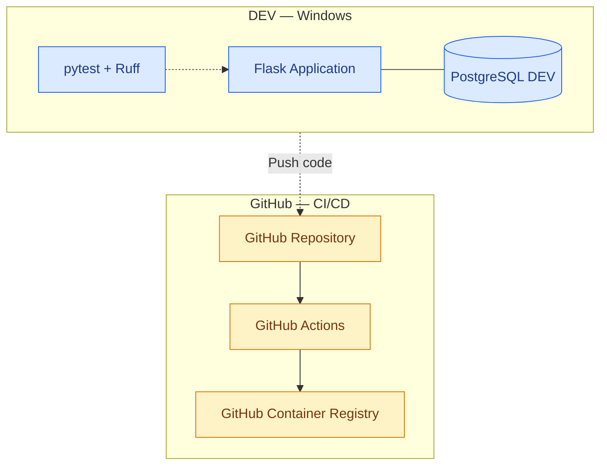
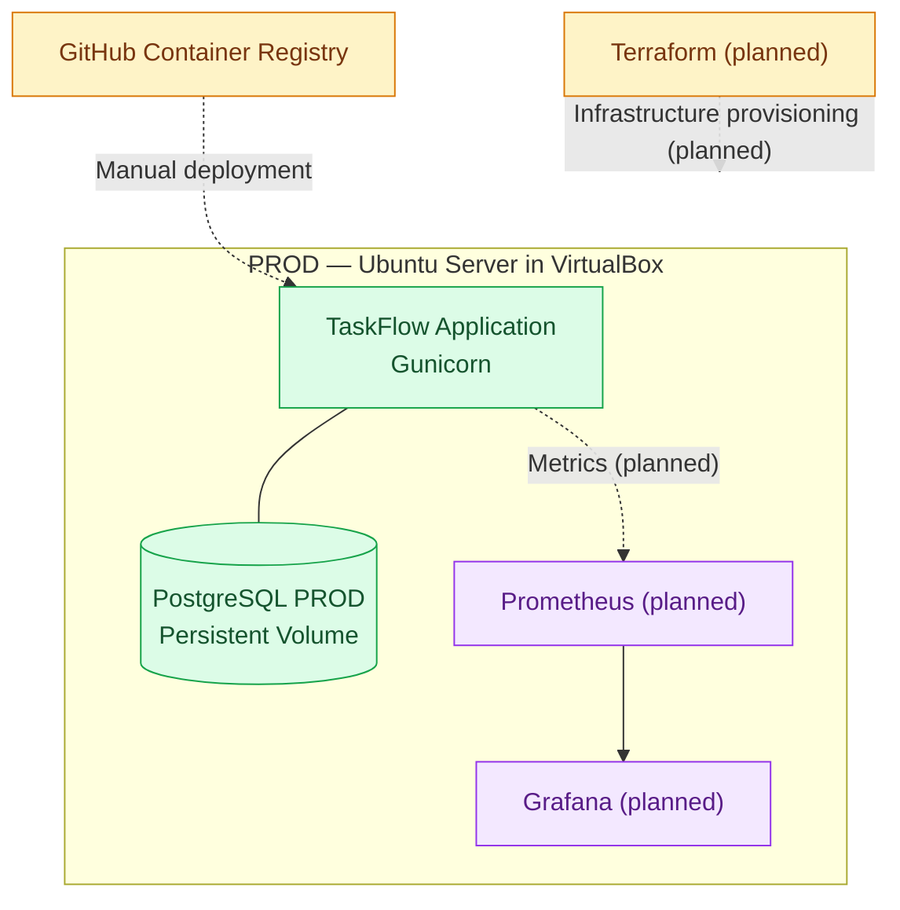

# TaskFlow - DevOps Diploma Project

---

## 1. Description

TaskFlow is a web application for task management, allowing users to create, edit, delete, and track tasks and their
completion status.

The project demonstrates practical DevOps practices, including automated testing, containerization, CI/CD,
Infrastructure as Code (IaC), and application monitoring.

The application uses separate development (DEV) and production (PROD) environments hosted locally.

---

## 2. Technology Stack

- Application: Python, Flask, HTML, Jinja2
- Database: PostgreSQL, SQLAlchemy
- Testing: pytest, Ruff
- Version Control: Git, GitHub
- CI/CD: GitHub Actions
- Containerization: Docker, Docker Compose
- Container Registry: GitHub Container Registry (GHCR)
- Application Server: Gunicorn
- Infrastructure as Code: Terraform (planned)
- Monitoring: Prometheus, Grafana (planned)
- Production Environment: Ubuntu Server, VirtualBox

---

## 3. Application Overview

TaskFlow is a web-based task management application built with Python and Flask.

Features:

- Create, view, edit, and delete tasks.
- Track task completion status.
- Check application availability through the `/health` endpoint.
- Use SQLAlchemy for database operations.
- Run PostgreSQL integration tests against a dedicated test database.

---

## 4. Environments

### DEV - Development Environment

- Runs locally on Windows using Docker Compose.
- Uses a dedicated PostgreSQL container and persistent data volume.
- Supports automated tests using pytest and code quality checks using Ruff.
- Uses a separate Compose configuration for PostgreSQL integration tests.

---

### PROD - Production Environment

- Runs on Ubuntu Server in VirtualBox.
- Uses Docker Engine and Docker Compose.
- Runs the application using Gunicorn.
- Uses a separate PostgreSQL container and persistent data volume.
- Application availability has been verified through the `/health` endpoint.
- The application can be accessed from Windows through an SSH tunnel.

---

## 5. CI/CD Pipeline

GitHub Actions automates code validation and Docker image publication.

---

### Continuous Integration (CI)

The workflow:

- Checks out the source code.
- Installs Python dependencies.
- Runs Ruff.
- Runs automated tests using pytest and a PostgreSQL service.
- Builds the Docker image after successful tests.
- Publishes the image to GHCR on pushes to the `main` branch.

The workflow has completed successfully, and the application image is available in GHCR.

Published image tags are configured as:

- `latest`
- Git commit SHA

---

### Continuous Deployment (CD)

Automatic deployment from GitHub Actions to the production server has not yet been implemented.

The current production deployment is performed separately on the Ubuntu Server VM.

---

## 6. Infrastructure as Code

Terraform configuration files will be created in `infra/terraform`, infrastructure provisioning has not yet been
implemented.

Docker Compose currently defines the application and database services.

---

## 7. Monitoring

Prometheus and Grafana are planned but not yet configured.

The `monitoring/` directory will contain the initial configuration structure. Application metrics and monitoring dashboards
remain to be implemented.

---

## 8. Repository Structure

- `app/` - Flask application source code.
- `tests/` - automated and integration tests.
- `infra/terraform/` - Terraform configuration.
- `monitoring/` - planned Prometheus and Grafana configuration.
- `.github/workflows/` - GitHub Actions workflow.
- `Dockerfile` - application image definition.
- `compose.yaml` - base service configuration.
- `compose.dev.yaml` - development configuration.
- `compose.prod.yaml` - production configuration.
- `compose.test.yaml` - integration test database configuration.
- `README.md` - project documentation.

---
## 9. Project Goals

- Develop a functional task management application.
- Automate code testing and quality checks.
- Build and publish Docker images to GHCR.
- Implement automated production deployment.
- Manage infrastructure using Terraform.
- Monitor application health and performance.
- Document deployment and recovery procedures.

---

## 10. Current Status

**Completed:**

- Flask application with CRUD functionality.
- Automated tests using pytest.
- Code quality checks using Ruff.
- Docker image build.
- Docker Compose configuration for the application and PostgreSQL.
- Separate PostgreSQL integration test environment.
- Production application server configured with Gunicorn.
- Ubuntu Server VM running the application.
- GitHub Actions workflow for testing and image publication.
- Successful publication of the application image to GHCR.

---
**Remaining:**

- Implement automatic deployment from GitHub Actions to PROD.
- Implement Terraform configuration.
- Configure Prometheus and Grafana.
- Add application metrics and monitoring dashboards.
- Document the complete deployment and recovery process.