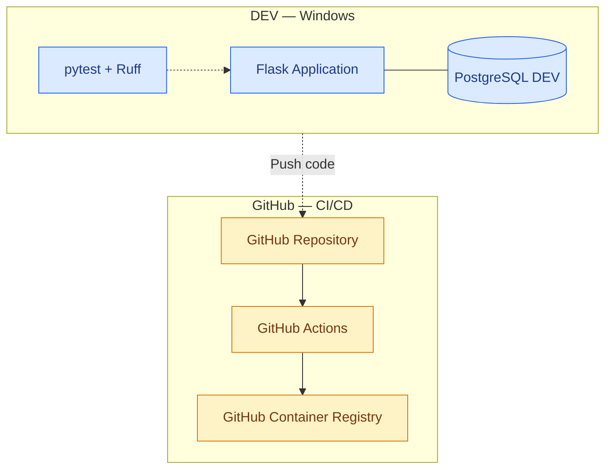
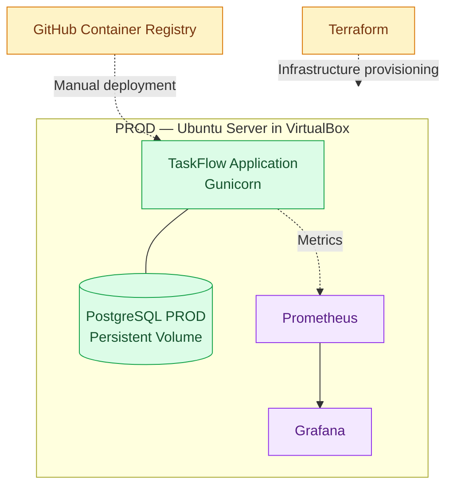

# TaskFlow - DevOps Diploma Project


TaskFlow is a containerized task management application built with Flask and PostgreSQL. 
The project demonstrates a DevOps workflow covering application development, automated testing, Docker 
image publishing, production deployment automation, infrastructure configuration, and monitoring.

The application uses separate development (DEV) and production (PROD) environments hosted locally.

---

## 1. Project Goals

- Containerize a Flask application and its database.
- Automate code quality checks and tests with GitHub Actions.
- Build and publish Docker images to GitHub Container Registry (GHCR).
- Prepare a production environment on an Ubuntu virtual machine.
- Configure application monitoring with Prometheus and Grafana.
- Manage infrastructure configuration with Terraform.
- Separate development, testing, and production environments.
- Maintain persistent database storage.
- Document the deployment and operational workflow.

---

## 2. Technology Stack

| Category               | Technologies                                   |
|------------------------|------------------------------------------------|
| Application            | Python, Flask, Jinja2                          |
| Database               | PostgreSQL, SQLAlchemy                         |
| Testing                | pytest                                         |
| Code Quality           | Ruff                                           |
| Containerization       | Docker, Docker Compose                         |
| CI/CD                  | GitHub Actions                                 |
| Container Registry     | GitHub Container Registry (GHCR)               |
| Production Server      | Ubuntu Server, VirtualBox                      |
| Application Server     | Gunicorn                                       |
| Infrastructure as Code | Terraform                                      |
| Monitoring             | Prometheus, prometheus-flask-exporter, Grafana |
| Private Connectivity   | Tailscale, SSH                                 |

---

## 3. Application Overview

TaskFlow is a web application for task management. It provides CRUD functionality, allowing users to create, view,
update, and delete tasks.

Features:

- Create, view, edit, and delete tasks.
- Track task completion status.
- Check application availability through the `/health` endpoint.
- Use SQLAlchemy for database operations.
- Run PostgreSQL integration tests against a dedicated test database.

---

## 4. Environments

### DEV - Development Environment

- Runs locally on Windows using Docker Compose.
- Uses a dedicated PostgreSQL container and persistent data volume.
- Supports automated tests using pytest and code quality checks using Ruff.
- Uses a separate Compose configuration for PostgreSQL integration tests.


---

### PROD - Production Environment

- Runs on Ubuntu Server in VirtualBox.
- Uses Docker Engine and Docker Compose.
- Runs the application using Gunicorn.
- Uses a separate PostgreSQL container and persistent data volume.
- Application availability has been verified through the `/health` endpoint.
- Supports private server access through Tailscale and SSH.
- Uses Prometheus and Grafana for application monitoring.



---

## 5. CI/CD Pipeline

GitHub Actions automates code validation and Docker image publication.


---

### Continuous Integration (CI)

The CI workflow:

- Checks out the source code.
- Installs Python dependencies.
- Runs Ruff for code quality checks.
- Runs automated tests using pytest and PostgreSQL.
- Builds the Docker image after successful tests.
- Publishes the image to GHCR on pushes to the `main` branch.

The workflow has completed successfully, and the application image is available in GHCR.

Published image tags are configured as:

- `latest`
- Git commit SHA

---

### Continuous Deployment (CD)

The deployment workflow automates application deployment to the production virtual machine.

The intended deployment process:

1. Establishes private connectivity through Tailscale.
2. Connects to the production server using SSH.
3. Retrieves the application image from GHCR.
4. Updates the application using Docker Compose.
5. Preserves persistent PostgreSQL data.
6. Verifies application health after deployment.

Production connection details and credentials are stored in GitHub Actions secrets rather than hardcoded in the
repository.


---

## 6. Infrastructure as Code

Terraform is used to manage infrastructure configuration in the development environment.

The Terraform configuration provisions a Docker network and supports repeatable infrastructure setup.

Docker Compose defines the application, database, and supporting services across the development, testing, and production environments.

Infrastructure configuration is maintained in version control to improve reproducibility and maintainability.

---

## 7. Monitoring

The monitoring stack consists of Prometheus and Grafana.

- **Prometheus** collects application metrics and monitors configured targets.
- **prometheus-flask-exporter** exposes Flask application metrics.
- **Grafana** visualizes metrics through dashboards.
- **HTTP request metrics** provide insight into application activity.
- **`/health`** provides an application health-check endpoint.
- **`/metrics`** exposes metrics for Prometheus scraping.

Prometheus is configured to scrape the application metrics endpoint. Grafana uses Prometheus as a data source to display application metrics.

---

## 8. Repository Structure

- `app/` - Flask application source code.
- `tests/` - automated and integration tests.
- `infra/` - Terraform configuration.
- `monitoring/` - Prometheus and Grafana configuration.
- `.github/workflows/` - GitHub Actions workflows for CI and production deployment.
- `Dockerfile` - application image definition.
- `compose.yaml` - base service configuration.
- `compose.dev.yaml` - development configuration.
- `compose.prod.yaml` - production configuration.
- `compose.test.yaml` - integration test database configuration.
- `README.md` - project documentation.

## 9. Running the Application

### Development
Start the development environment:

```bash
docker compose -f compose.dev.yaml up -d --build
```

Check the running containers:
```bash
docker compose -f compose.dev.yaml ps
```
---

### Testing

Run the testing environment:
```bash
docker compose -f compose.test.yaml up --build --abort-on-container-exit
```

Check the test results before stopping or removing any containers.

---

### Production

The production environment runs on an Ubuntu Server virtual machine using Docker Compose.

Production configuration and secrets are maintained separately from the application source code. PostgreSQL data is stored in a persistent Docker volume.

The production deployment process uses the Docker image published to GitHub Container Registry (GHCR).


---

## 10. Security and Reliability

- Secrets are stored in environment variables and GitHub Actions secrets.
- Private server access is provided through Tailscale and SSH.
- PostgreSQL data is stored in a persistent Docker volume.
- Automated tests validate application functionality and database integration.
- Health checks help verify application availability.
- Docker images are tagged with the corresponding Git commit SHA to support version identification.

---

## Project Summary

TaskFlow demonstrates the integration of application development and DevOps practices, including containerization, automated testing, CI/CD, infrastructure configuration, production deployment, persistent storage, and monitoring.

The project uses Docker and Docker Compose to manage application environments, GitHub Actions to automate CI/CD workflows, Terraform to configure infrastructure, and Prometheus and Grafana to monitor application activity.


